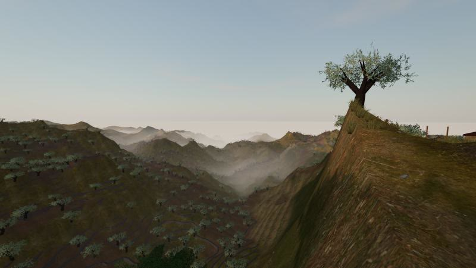
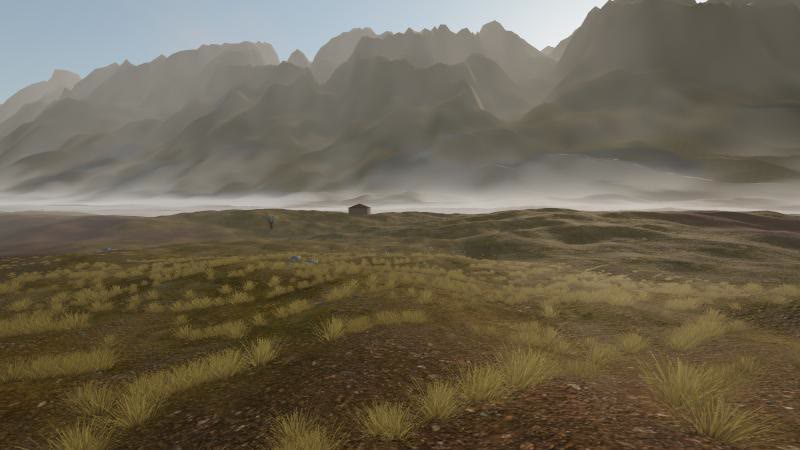
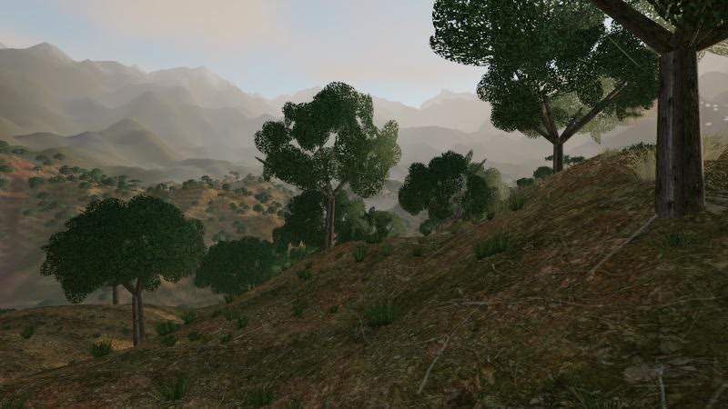
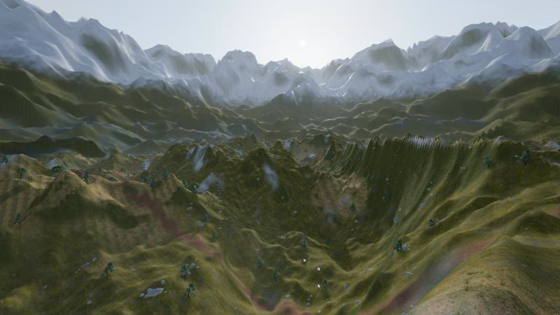
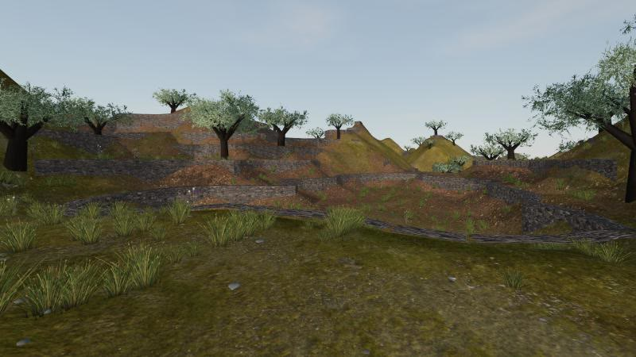
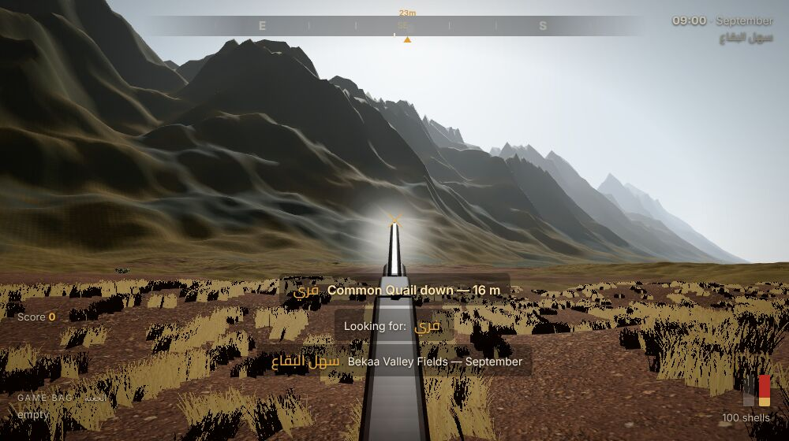

# Lebanon Hunt 3D

A first-person 3D bird-hunting game for the browser, set in real Lebanese hunting country:
olive terraces above the sea, the Bekaa stubble fields, the Chouf oak woods and the high juniper
country of Akkar. It runs in Chrome/Edge/Firefox with no install, and you can hunt together with
friends over the internet using a 5-letter code.

| Koura olive terraces at dawn | Bekaa fields, ground mist | Chouf oak woods, afternoon |
|---|---|---|
|  |  |  |
| **Akkar juniper highlands** | **Dry-stone terraces** | **A quail down in the Bekaa** |
|  |  |  |

## The birds

The game birds are the ones hunters go out for in Lebanon. The game is in English; the Arabic option uses Modern Standard Arabic names.

| Name | Bird | Where & when in the game | How it behaves |
|---|---|---|---|
| **Quail** (السمّان) | Common Quail, *Coturnix coturnix* | Bekaa stubble, September | Sits tight in the grass and bursts up at your feet with a loud whirr, then flies low and straight for 60–150 m and drops back in. You can walk it up again. Small groups (coveys) are common. |
| **Song thrush** (السمنة المغرّدة) | Song Thrush, *Turdus philomelos* | Koura olive terraces, October–November | Passes at first light along flight lines, singly or in small groups, with a thin *tsip* call. Some drop into the olive trees to feed and flush when you get close. |
| **Chaffinch** (الشرشور) | Common Chaffinch, *Fringilla coelebs* | Olive groves & highlands, October–November | Flocks with a bounding flap-and-close flight, white wing bars and a *pink-pink* call. Small and quick. |
| **Fieldfare** (سمنة الحقول) | Fieldfare / Mistle Thrush, *Turdus pilaris* | Akkar juniper highlands, January | A big winter thrush in loose, noisy *chack-chack* flocks over the junipers (لزاب). |
| **Woodcock** (دجاجة الأرض) | Eurasian Woodcock, *Scolopax rusticola* | Chouf oak woods, December, late afternoon | Hides on the leaf litter, flushes very late and twists between the trees. The prize bird, worth the most points. |
| **Turtle dove** (القمري) | European Turtle Dove, *Streptopelia turtur* | Bekaa and Koura, late summer | Small, fast dove on flicking wingbeats, passing in small parties and purring from the trees. Declining — take few. |
| **Woodpigeon** (الحمام الخشبي) | Common Woodpigeon, *Columba palumbus* | Chouf and Akkar woods, winter | Big, tough and wary: claps its wings as it clatters out of a tree, white wing bands flashing. Needs a well-placed shot. |
| **White stork** (اللقلق الأبيض) | White Stork, *Ciconia ciconia* | Overhead in migration | **Protected.** Shooting one costs you 250 points. |


## How realistic is it?

- **Shot pellets are simulated.** Each cartridge fires 350–580 pellets (#7½, #8 or #9) with drag,
  gravity, wind drift and time of flight. A crossing thrush at 30 m needs about 1.5 m of lead. You
  choose the choke of each barrel (Cylinder to Full); the spreads are tuned so the share of pellets
  in a 75 cm circle at 40 yards matches real patterning (IC about 50%, Full about 70%). The effective
  range is around 35–40 m, and past about 55 m the pellets can't kill cleanly.
- **Birds behave like birds.** Flocks fly as real flocks, bunch, split when shot at and reform.
  They spot a hunter moving in the open (hills and trees block their view), flare and swerve away;
  perched birds watch you and go when you stand up close. Quail often run before they flush,
  woodcock jink between the trunks, and wounded birds tower and fall, glide down far off, or carry
  on. Game birds flush into the wind and are wilder on a windy day.
- **Weather.** Each day picks its weather from what that ground gets in that month: morning fog
  in the Koura valleys that burns off by half past nine, dawn ground fog and hot haze in the Bekaa,
  overcast, drizzle, rain and mist in the Chouf, snow showers in Akkar, passing showers. Rain wets
  the ground and keeps birds down; fog hides you from them but also hides them from you.
- **Wind and migration.** Each day has its own wind (mostly westerly off the sea, strongest on the
  highlands) and its own passage: some mornings the thrush pour through, others are quiet.
- **Birds aren't always killed by one hit.** A bird hit by too few pellets may carry on wounded
  and drop later. Watch where it goes.
- **Real proportions.** Birds are their real size (a quail is 18 cm), so at 30 m it is a small
  target, just like in real life. The binoculars help you spot them.
- **Landscape.** The ground uses CC0 photo-scanned textures: dry grass, terra-rossa soil, oak leaf
  litter, limestone, dry-stone terrace walls and snow. The trees are procedural olives, Palestine
  oak, umbrella stone pine, Greek juniper and Lebanon cedar. There's a traditional stone house with a
  red-tile roof, a village on the far ridge, the Mediterranean to the west and snow on the peaks
  in winter.
- **Light.** The sun follows the real track for Lebanon (34°N) in each month, from first light
  through to dusk.
- **Sound.** Real recordings of each species' calls and songs, and recorded-style effects for the
  gun, wings, footsteps (grass, leaves, gravel, stone, snow), the dog and the countryside. Sound
  travels at the speed of sound, loses its highs with distance, is muffled behind hills, and your
  shot echoes back off the actual slopes and far ridges around you. The ambience follows the hour,
  month, trees and wind: dawn birdsong, cicadas in September, crickets at dusk, far roosters, dogs,
  sheep bells and church bells. Headphones let you place a calling flock by ear.

## Controls

| Key | Action |
|---|---|
| Mouse | Look |
| **Right mouse** (hold) | Mount the gun and look down the rib |
| **Left mouse** | Fire (lower barrel, then upper barrel) |
| **R** | Break open and reload (also happens when you click with both barrels empty) |
| **W A S D** / Shift / C / Space | Walk / run / crouch / jump |
| **E** | Pick up a downed bird |
| **B** | Binoculars: birds you look at are marked with species and distance for 30 s |
| **Q** | Blow your caller: thrush whistle (flocks turn in), quail call (hidden quail answer), dove cooer (doves and pigeons come to the trees) |
| **V** (or 1–3) | Change caller |
| **F** | Dog: send it in when it's on point, otherwise heel / hunt on |
| **G** | Set out three decoys in front of you (again, near them, to pick them up) |
| **M** | Map of the hunting ground |
| **Tab** (hold) | Game bag, scores, your last shots, and notes on each bird |
| **Enter** | Chat (multiplayer) |
| Esc | Pause / release the mouse |

**Gamepad** (PlayStation or Xbox): left stick walk, right stick look, **R2** fire, **L2** mount,
✕/A jump, ○/B crouch, □/X reload, △/Y pick up, **L1** binoculars, **R1** whistle, d-pad up dog,
d-pad down map, d-pad right change caller, L3 run, R3 decoys, Options pause.

The compass at the top marks downed birds (gold ones are yours) with their distance, and your dog
when it's on point. The arrow under the clock shows where the wind is blowing.

Tips: crouch and move slowly to get close to perched thrush. Walk the stubble in a line to flush
quail. In the woods, woodcock flush within a few metres, so keep the gun ready.

## Finding birds

- **Birds you can see.** By default birds are drawn about 1.8× life size (and hit as big as they
  look); switch to "Realistic" under Settings → Aiming help for true size. They stand out dark
  against the sky.
- **Spotting.** Look at birds through the binoculars (B) and they're marked with species and
  distance, on screen and on the compass. Arrows at the edge of the screen show flocks heading
  your way.
- **Need zones**, as in theHunter: Call of the Wild. Each ground has feeding, roosting and drinking
  spots that birds use at set hours (thrush in the olive groves at dawn, woodpigeon in the oaks
  mid-morning, doves at the water in the evening…). Find one by spotting birds there or finding
  feathers and droppings; it then shows on the map (M) with its hours. A line under the compass
  always tells you what to do next.
- **Visibility and noise meters** show how much the birds can see and hear of you.

## Your dog, your companion and the practice boards

- **The pointer.** It works the ground in a zig-zag ahead of you and winds hidden
  quail and woodcock — from much further when the breeze carries the scent to it. When it locks
  on point, its bell goes quiet (listen for the silence). Walk in, or press **F** to send it in.
  It retrieves the birds you drop. You can leave it at home from the menu.
- **Your companion** calls out incoming birds ("Thrush coming in!", "Birds on your left!"), warns you
  about storks and unsafe shots, and comments on your shooting, in English (or standard Arabic).
  Switch him off in Settings → Sound.
- **Practice boards** stand at 20, 30 and 40 m to the right of where you start. Shoot one to see
  the real pattern of your choke and cartridge, with the count in the 75 cm circle.
- **How did I miss?** After each shot at a bird the game tells you where the pattern went:
  behind or ahead of a crossing bird, over or under, and by how much. The end-of-hunt summary
  turns that into advice.
- **Decoys**: woodpigeon, turtle-dove or thrush decoys, set out into the wind. Passing
  flocks of the same kind may swing in low over them — if nobody is moving about in the open.
- **Harvest, trophies and levels** (as in theHunter: Call of the Wild): every bird has its own
  weight, the heaviest earn bronze, silver, gold or diamond medals, and each bird you bag gets a
  harvest card. Your best bird of each kind hangs in the **trophy lodge** on the menu, and every
  harvest earns XP towards your hunter level.
- **Challenges**: a right and left, five quail without a miss, woodcock at dusk, a
  thrush at 40 m and more, with one daily challenge worth a bonus.
- **Map (M)**, **bird guide** with portraits and real calls, and a full
  **Arabic interface** in Modern Standard Arabic (switch at the top of the menu; English is the default).

## Hunting with friends

1. One player clicks **Host a hunt with friends**. A 5-letter code appears at the top-left.
2. Everyone else types the code and clicks **Join**.

The host's browser runs the birds, and everyone connects to it peer-to-peer over WebRTC (via the
free PeerJS signalling server), so you don't need your own server. Each player can see the
others, hear their shots and see their birds fall. Birds go into the shooter's bag, whoever picks
them up.

If a friend can't connect (some strict office or school networks block WebRTC), try a home or
mobile connection.

A shot fired with another hunter in your line costs 50 points, as it would get you sent home on a
real hunt.

## Run it

```bash
npm install
npm run dev        # http://localhost:5173 (also shared on your LAN)
npm run build      # static site in dist/
npm run preview
```

### Put it online (GitHub Pages)

The repo includes `.github/workflows/deploy.yml`. To use it:

1. In the GitHub repo, go to **Settings → Pages** and set **Source** to **GitHub Actions**.
2. Push to `main`, or run the workflow by hand from the **Actions** tab.

The game will then be live at `https://<user>.github.io/<repo>/`. Send your friends the link and a
hunt code.

The `dist/` folder is plain static files, so it also works on Netlify, Vercel or itch.io.

## Settings

Everything is in **Settings** (menu or pause screen) and is saved for next time:

- **Controls**: mouse sensitivity, sensitivity with the gun mounted, field of view, invert.
- **Gun**: the choke of each barrel and the cartridge size.
- **Graphics**: **Auto** (default) picks a tier for your graphics card. **Low** has no shadows or
  post-processing, for laptops. **Medium** adds shadows, bloom and colour grading. **High** adds
  ambient occlusion and sharper, wider shadows. **Ultra** raises everything for a strong card.
  Render scale can be fixed, or left dynamic to hold the frame rate.
- **Sound**: separate volumes for the gun and steps, bird calls, ambience, voices and music.
- **Aiming help**: aiming dot, hit marker, miss feedback and compass markers — turn them off for a
  more realistic hunt.

## Code map

```
src/
  main.js                 game loop, menus, multiplayer glue
  config/species.js       the birds: sizes, colours, flight style, toughness, points
  config/hunts.js         the five hunting grounds (terrain, trees, birds, month, time)
  world/terrain.js        heightfield, terraces, distant mountains, sea, splat-mapped ground shader
  world/vegetation.js     procedural olive / oak / pine / juniper / cedar / shrubs (instanced)
  world/grass.js          grass around the player
  world/sky.js            sun path, sky, clouds, fog, image-based lighting
  world/structures.js     stone house, village
  world/rocks.js, ground.js  terrace walls, boulders, pebbles, thistles
  gfx/                    quality tiers, post-processing, colour grading, dust and leaves
  birds/birdModel.js      procedural bird models with painted plumage and flapping wings
  birds/birds.js          bird behaviour: flocking, sight, flush, perching, wounds, falling
  dog/dog.js              the pointer: quartering, scenting, pointing, retrieving
  player/player.js        first-person movement, footsteps by surface
  player/shotgun.js       over-under shotgun, chokes, cartridges, pellet ballistics, shot analysis
  player/boards.js        patterning boards
  audio/audio.js          mixer, samples, echoes off the terrain, ambience
  audio/companion.js      the companion's spoken calls (browser text-to-speech)
  core/                   input (keyboard, mouse, gamepad), settings, wind, challenges, i18n
  ui/                     HUD, map, bird guide
  net/net.js, avatar.js   peer-to-peer multiplayer and other hunters' avatars
tools/audio/              scripts that make public/audio from recordings and ElevenLabs
```

### Remaking the sounds

`public/audio` is built by `tools/audio/process.py` from the raw ElevenLabs files in
`tools/audio/raw` and the bird recordings listed in `tools/audio/commons_credits.json`
(`tools/audio/fetch_commons.py` downloads them). New ElevenLabs effects and voice lines are made
with `tools/audio/elevenlabs-sfx.mjs` and `tools/audio/elevenlabs-voice.mjs`; put your key in
`.env.local` as `ELEVENLABS_API_KEY=...` (that file is git-ignored).

## Credits

- Ground, bark, stone and roof textures: [Poly Haven](https://polyhaven.com) (CC0).
- 3D engine: [three.js](https://threejs.org). Multiplayer: [PeerJS](https://peerjs.com).
- Bird recordings: xeno-canto recordists via Wikimedia Commons (CC BY-SA 4.0), listed in
  [public/audio/CREDITS.md](public/audio/CREDITS.md).
- Effects and ambience: generated with [ElevenLabs](https://elevenlabs.io).
- Everything else (trees, birds, dog, gun, sky) is generated in code.

Please hunt responsibly and within Lebanese law. Respect the seasons and the bag limits, and never
shoot protected species.
