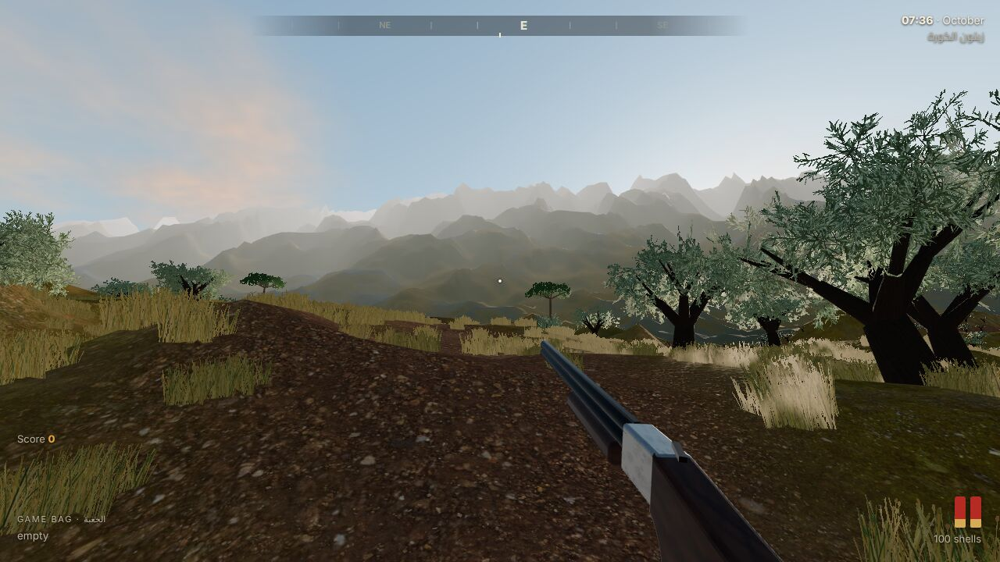
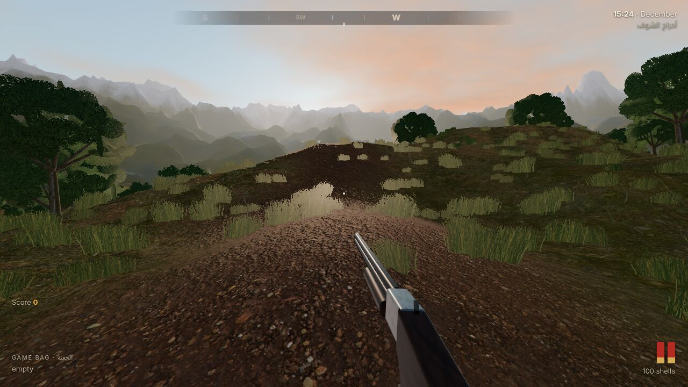

# صيد لبنان · Lebanon Hunt 3D

A first-person 3D bird-hunting game for the browser, set in real Lebanese hunting country:
olive terraces above the sea, the Bekaa stubble fields, the Chouf oak woods and the high juniper
country of Akkar. It runs in Chrome/Edge/Firefox with no install, and you can hunt together with
friends over the internet using a 5-letter code.

| Koura olive terraces at dawn | Chouf woods, December dusk | A quail down in the Bekaa |
|---|---|---|
|  |  |  |

## The birds

The game birds are the ones Lebanese hunters go out for, named the way hunters name them.

| Name | Bird | Where & when in the game | How it behaves |
|---|---|---|---|
| **فري** (Ferri) | Common Quail, *Coturnix coturnix* | Bekaa stubble, September | Sits tight in the grass and bursts up at your feet with a loud whirr, then flies low and straight for 60–150 m and drops back in. You can walk it up again. Small groups (coveys) are common. |
| **سمن** (Summun) | Song Thrush, *Turdus philomelos* | Koura olive terraces, October–November | Passes at first light along flight lines, singly or in small groups, with a thin *tsip* call. Some drop into the olive trees to feed and flush when you get close. |
| **صلنج** (Salanj) | Common Chaffinch, *Fringilla coelebs* | Olive groves & highlands, October–November | Flocks with a bounding flap-and-close flight, white wing bars and a *pink-pink* call. Small and quick. |
| **كيخن** (Kikhen) | Fieldfare / Mistle Thrush, *Turdus pilaris* | Akkar juniper highlands, January | A big winter thrush in loose, noisy *chack-chack* flocks over the junipers (لزاب). |
| **شكب** (Shikab) | Eurasian Woodcock, *Scolopax rusticola* | Chouf oak woods, December, late afternoon | Hides on the leaf litter, flushes very late and twists between the trees. The prize bird, worth the most points. |
| لقلق أبيض | White Stork | Overhead in migration | **Protected.** Shooting one costs you 250 points. |

> Note on names: Lebanese dialect names vary by region. In Lebanon, شكب is used for the woodcock
> (in Syria it usually means the jack snipe), and كيخن covers the fieldfare and the mistle thrush
> ("كيخن لزاب"). If your village uses a name differently, it's a one-line change in
> `src/config/species.js`.

## How realistic is it?

- **Shot pellets are simulated.** Each cartridge fires about 400 #8 pellets with drag, gravity and
  time of flight. A crossing thrush at 30 m needs about 1.5 m of lead. The two barrels have
  different chokes (Improved Cylinder, then Full). The effective range is around 35–40 m, and past
  about 55 m the pellets can't kill cleanly.
- **Birds aren't always killed by one hit.** A bird hit by too few pellets may carry on wounded
  and drop later. Watch where it goes.
- **Real proportions.** Birds are their real size (a quail is 18 cm), so at 30 m it is a small
  target, just like in real life. The binoculars help you spot them.
- **Landscape.** The ground uses CC0 photo-scanned textures: dry grass, terra-rossa soil, oak leaf
  litter, limestone, dry-stone terrace walls and snow. The trees are procedural olives, Palestine
  oak, umbrella stone pine, Greek juniper and Lebanon cedar. There's a traditional stone house with a
  red-tile roof, a village on the far ridge, the Mediterranean to the west and snow on the peaks
  in winter.
- **Light.** The sun follows the real track for Lebanon (34°N) in each month, from first light
  through to dusk.
- **Sound.** Every sound is synthesised: the shot echoing round the valley, the wing whirr on a
  flush, each species' call, the hunter's whistle, footsteps on leaves, and other hunters
  shooting far off across the valley.

## Controls

| Key | Action |
|---|---|
| Mouse | Look |
| **Right mouse** (hold) | Mount the gun and look down the rib |
| **Left mouse** | Fire (lower barrel, then upper barrel) |
| **R** | Break open and reload (also happens when you click with both barrels empty) |
| **W A S D** / Shift / C / Space | Walk / run / crouch / jump |
| **E** | Pick up a downed bird |
| **B** | Binoculars |
| **Q** | Whistle: passing thrush and finch flocks may turn towards you or drop into nearby trees |
| **Tab** (hold) | Game bag, scores, and notes on each bird |
| **Enter** | Chat (multiplayer) |
| Esc | Pause / release the mouse |

The compass at the top marks downed birds (gold ones are yours) with their distance.

Tips: crouch and move slowly to get close to perched thrush. Walk the stubble in a line to flush
quail. In the woods, woodcock flush within a few metres, so keep the gun ready.

## Hunting with friends

1. One player clicks **Host a hunt with friends**. A 5-letter code appears at the top-left.
2. Everyone else types the code and clicks **Join**.

The host's browser runs the birds, and everyone connects to it peer-to-peer over WebRTC (via the
free PeerJS signalling server), so you don't need your own server. Each player can see the
others, hear their shots and see their birds fall. Birds go into the shooter's bag, whoever picks
them up.

If a friend can't connect (some strict office or school networks block WebRTC), try a home or
mobile connection.

## Run it

```bash
npm install
npm run dev        # http://localhost:5173 (also shared on your LAN)
npm run build      # static site in dist/
npm run preview
```

### Put it online (GitHub Pages)

The repo includes `.github/workflows/deploy.yml`. To use it:

1. In the GitHub repo, go to **Settings → Pages** and set **Source** to **GitHub Actions**.
2. Push to `main`, or run the workflow by hand from the **Actions** tab.

The game will then be live at `https://<user>.github.io/<repo>/`. Send your friends the link and a
hunt code.

The `dist/` folder is plain static files, so it also works on Netlify, Vercel or itch.io.

## Graphics settings

- **Low**: no shadows, fewer trees and less grass. For laptops with integrated graphics.
- **Medium**: the default.
- **High**: bigger shadow maps, denser terrain and more vegetation. For a gaming PC.

## Code map

```
src/
  main.js                 game loop, menus, multiplayer glue
  config/species.js       the birds: sizes, colours, flight style, toughness, points
  config/hunts.js         the five hunting grounds (terrain, trees, birds, month, time)
  world/terrain.js        heightfield, terraces, distant mountains, sea, splat-mapped ground shader
  world/vegetation.js     procedural olive / oak / pine / juniper / cedar / shrubs (instanced)
  world/grass.js          grass around the player
  world/sky.js            sun path, sky, clouds, fog, image-based lighting
  world/structures.js     stone house, village
  birds/birdModel.js      procedural bird models with painted plumage and flapping wings
  birds/birds.js          bird behaviour: flush, flight lines, perching, flocks, falling
  player/player.js        first-person movement
  player/shotgun.js       over-under shotgun model, reload, pellet ballistics
  audio/audio.js          synthesised sound
  net/net.js, avatar.js   peer-to-peer multiplayer and other hunters' avatars
```

## Credits

- Ground, bark, stone and roof textures: [Poly Haven](https://polyhaven.com) (CC0).
- 3D engine: [three.js](https://threejs.org). Multiplayer: [PeerJS](https://peerjs.com).
- Everything else (trees, birds, gun, sounds, sky) is generated in code.

Please hunt responsibly and within Lebanese law. Respect the seasons and the bag limits, and never
shoot protected species.
